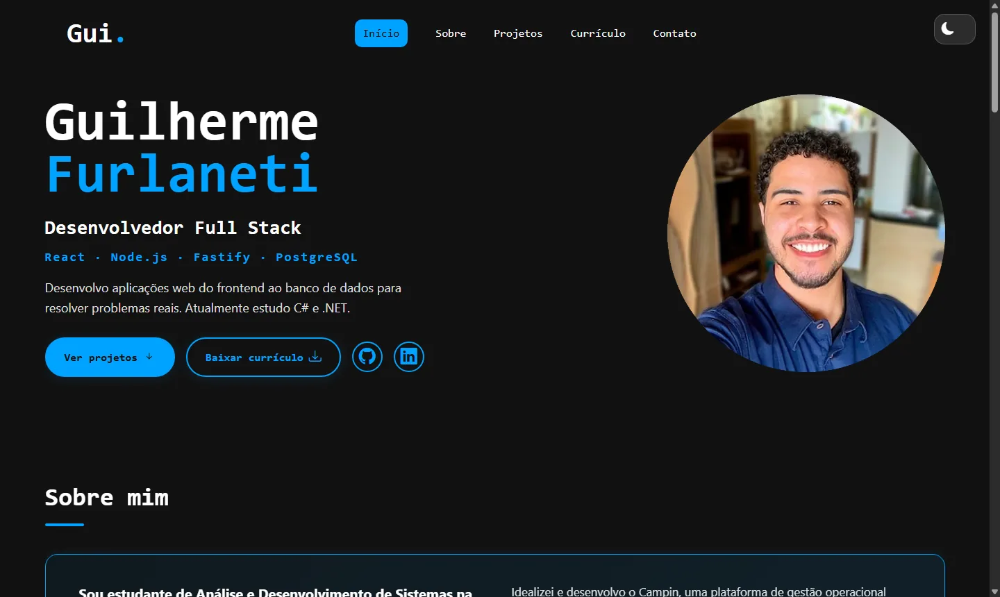
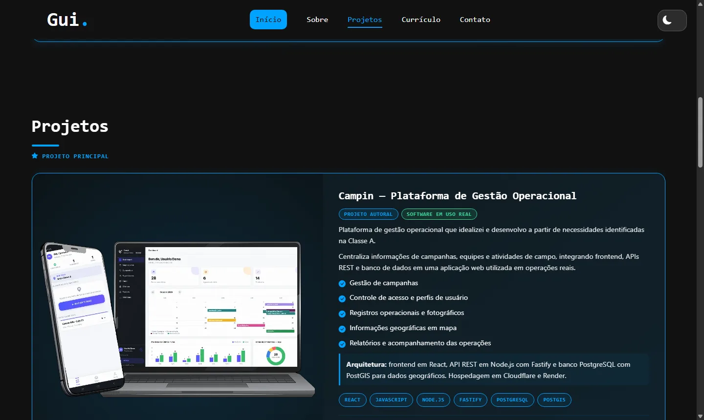

# Portfólio — Guilherme Furlaneti

Portfólio pessoal de **Guilherme Furlaneti**, desenvolvedor full stack com experiência prática em **React, Node.js/Fastify e PostgreSQL** e estudos em C# e .NET. Reúne apresentação, projetos, currículo e contatos.

**Site publicado:** [guifurlaneti.github.io/portfolio](https://guifurlaneti.github.io/portfolio/)





---

## Conteúdo do site

- **Início:** nome, cargo-alvo, stack e atalhos para projetos, currículo, GitHub e LinkedIn.
- **Sobre:** formação, objetivo profissional e contexto do trabalho atual.
- **Projetos:**
  - **Campin** (projeto principal): plataforma de gestão operacional com React, Node.js/Fastify e PostgreSQL/PostGIS. Galeria com 5 telas demonstrativas (dashboard, campanhas, evidências e mapa, relatórios e interfaces móveis). O código é privado; o card leva ao [showcase público](https://github.com/GuiFurlaneti/ShowcaseCampin) e ao case técnico em PDF hospedado nele.
  - **Classe Eventos:** site institucional comercial, com pedido de orçamento enviado pelo WhatsApp.
  - **To-do App:** projeto pessoal de aprendizado em React, com dados salvos no navegador.
  - **Waca:** projeto backend .NET em desenvolvimento (estrutura em camadas e primeiras entidades).
  - **Contribuições em projetos colaborativos:** Menu Digital (UI/UX) e Aluga Simples (UI/UX em 2024 e contribuição frontend na V2).
- **Currículo:** abas de Experiências, Educação e Habilidades.
- **Contato:** e-mail, LinkedIn, GitHub, WhatsApp e Behance.

O currículo em PDF fica em [`docs/curriculo-guilherme-furlaneti.pdf`](docs/curriculo-guilherme-furlaneti.pdf). As capturas do Campin exibidas no site são demonstrativas, com dados fictícios.

## Tecnologias do site

- **HTML5** semântico
- **CSS3** com variáveis, tema claro/escuro e layout responsivo (sem framework CSS)
- **JavaScript vanilla**
- **Manrope** (Google Fonts, `font-display: swap`) e fonte monoespaçada do sistema para etiquetas técnicas
- **Bootstrap Icons** (via CDN)

## Recursos

- Tema claro e escuro: segue a preferência do sistema e salva a escolha manual no navegador
- Menu mobile com `aria-expanded` e fechamento por `Esc`
- Abas do currículo no padrão WAI-ARIA (setas, `Home` e `End`)
- Projetos em grid responsivo; miniaturas do Campin abrem a galeria na imagem escolhida
- Lightbox de imagens com foco preso no diálogo, `Esc` para fechar e retorno de foco
- Animações de entrada que respeitam `prefers-reduced-motion`
- Imagens em WebP com `loading="lazy"` abaixo da dobra

## Estrutura

```
portfolio/
├── index.html
├── css/
│   └── styles.css
├── js/
│   ├── curriculo-tabs.js      # abas do currículo
│   ├── dark-mode.js           # alternância de tema
│   ├── mobile-menu.js         # menu de navegação no mobile
│   ├── nav-active.js          # link ativo do menu conforme a rolagem
│   ├── projeto-lightbox.js    # lightbox das imagens dos projetos e miniaturas
│   └── scroll-animation.js    # animações de entrada
├── img/
│   ├── favicon_io/            # favicons e web manifest
│   ├── logos-empresas/        # logos de empresas, instituições e tecnologias
│   ├── readme/                # capturas usadas neste README
│   └── secao-projetos/        # imagens dos projetos
└── docs/
    └── curriculo-guilherme-furlaneti.pdf
```

## Como executar localmente

O site é estático e não precisa de build. Basta servir a pasta com qualquer servidor HTTP, por exemplo:

```bash
python -m http.server 8000
```

Depois acesse `http://localhost:8000`.

## Publicação

O site é publicado pelo **GitHub Pages** a partir deste repositório.
